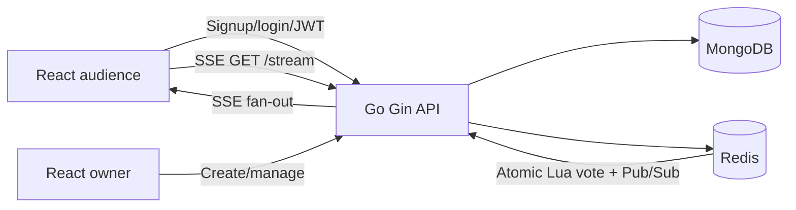

# LivePulse

LivePulse is a real-time polling application built with React, Go/Gin, MongoDB, and Redis.

## Architecture



MongoDB stores users, polls, and durable vote documents. Redis owns live option counters, duplicate-voter protection, Pub/Sub updates, rate-limit windows, and short-lived viewer-presence entries.

## Run locally

Requirements: Docker Desktop, or native Go 1.26, MongoDB, and Redis.

```bash
cp .env.example .env
docker compose up --build
```

- Frontend: http://localhost:4173
- Backend: http://localhost:8080
- Health: http://localhost:8080/healthz
- MongoDB: localhost:27017
- Redis: localhost:6379

Native frontend development:

```bash
cd frontend
npm install
npm run dev
```

Native backend development:

```bash
cd backend
cp .env.example .env
go run ./cmd/server
```

## Environment variables

| Variable | Required | Purpose |
|---|---:|---|
| `MONGO_URI` | Yes | MongoDB connection URI |
| `MONGO_DATABASE` | Yes | MongoDB database name |
| `REDIS_URL` | Yes | Redis URL |
| `JWT_SECRET` | Yes | HMAC signing secret, at least 32 characters |
| `JWT_ISSUER` | Yes | JWT issuer |
| `JWT_EXPIRY` | Yes | JWT lifetime, for example `24h` |
| `ALLOWED_ORIGINS` | Yes | Comma-separated frontend origins |
| `COOKIE_SECURE` | Yes locally | Set `true` only behind HTTPS |
| `HTTP_ADDR` | Yes | HTTP listen address |
| `MAX_BODY_BYTES` | Yes | Maximum JSON request size |
| `VITE_API_URL` | Yes | Public backend URL used by React |

## API

| Method | Route | Access | Purpose |
|---|---|---|---|
| `GET` | `/healthz` | Public | Health check |
| `POST` | `/api/auth/signup` | Public | Create account |
| `POST` | `/api/auth/login` | Public | Login and receive JWT |
| `POST` | `/api/polls` | JWT | Create poll |
| `GET` | `/api/polls/mine` | JWT | List owned polls |
| `PATCH` | `/api/polls/:slug/close` | JWT | Close owned poll |
| `DELETE` | `/api/polls/:slug` | JWT | Delete owned poll |
| `GET` | `/api/polls/:slug` | Public | Fetch poll |
| `GET` | `/api/polls/:slug/results` | Public | Fetch counts |
| `POST` | `/api/polls/:slug/vote` | Public | Submit one vote |
| `GET` | `/api/polls/:slug/stream` | Public | SSE live results |

## Key decisions

- **SSE instead of WebSockets:** one-way server updates require less protocol complexity and integrate cleanly with HTTP reconnect.
- **Lua vote script:** Redis atomically rejects duplicate voter IDs and increments counters before publishing.
- **MongoDB vote documents:** Redis counters provide speed and live updates; MongoDB provides durable history and reconstruction after Redis eviction.
- **Voter cookie:** an `httpOnly` random cookie provides a useful default identity, but it is not proof of personhood. Incognito mode, cookie clearing, or shared devices can change or bypass the identity.
- **Cross-domain cookies:** production requires `COOKIE_SECURE=true`, `SameSite=None`, HTTPS, and an exact CORS allow-list.
- **Viewer presence:** Redis sorted sets expire stale connections; active SSE connections refresh their presence.

## Testing

```bash
cd backend
go test -p 1 ./...
cd ../frontend
npm run build
npm run lint
./scripts/smoke.sh https://your-api.example poll-slug
```

The backend includes miniredis duplicate-voter tests and a 200-voter concurrency test.

## Deployment

1. Create a MongoDB Atlas free cluster and database-user password.
2. Create a Redis provider that supports Pub/Sub and persistence/reconnect behavior.
3. Deploy the backend from `backend/` with Go 1.26 or `backend/Dockerfile`.
4. Set `MONGO_URI`, `MONGO_DATABASE`, `REDIS_URL`, `JWT_SECRET`, `ALLOWED_ORIGINS`, `COOKIE_SECURE=true`, and `JWT_ISSUER`.
5. Deploy `frontend/` to Vercel or Netlify using `VITE_API_URL=https://your-backend.example`.
6. Set `ALLOWED_ORIGINS=https://your-frontend.example` exactly.
7. Verify HTTPS and cookies before testing the cross-domain audience flow.
8. If the backend host sleeps, call `/healthz` every 5–10 minutes from an external uptime monitor.

Post-deploy test:

- Open `/healthz`.
- Sign up and log in.
- Create a poll.
- Open its link in two browsers.
- Submit different voter identities.
- Confirm both screens update without refresh.
- Close or expire the connection and confirm reconnection loads full results.
- Confirm duplicate voting is rejected.
- Confirm close/delete require authentication.
